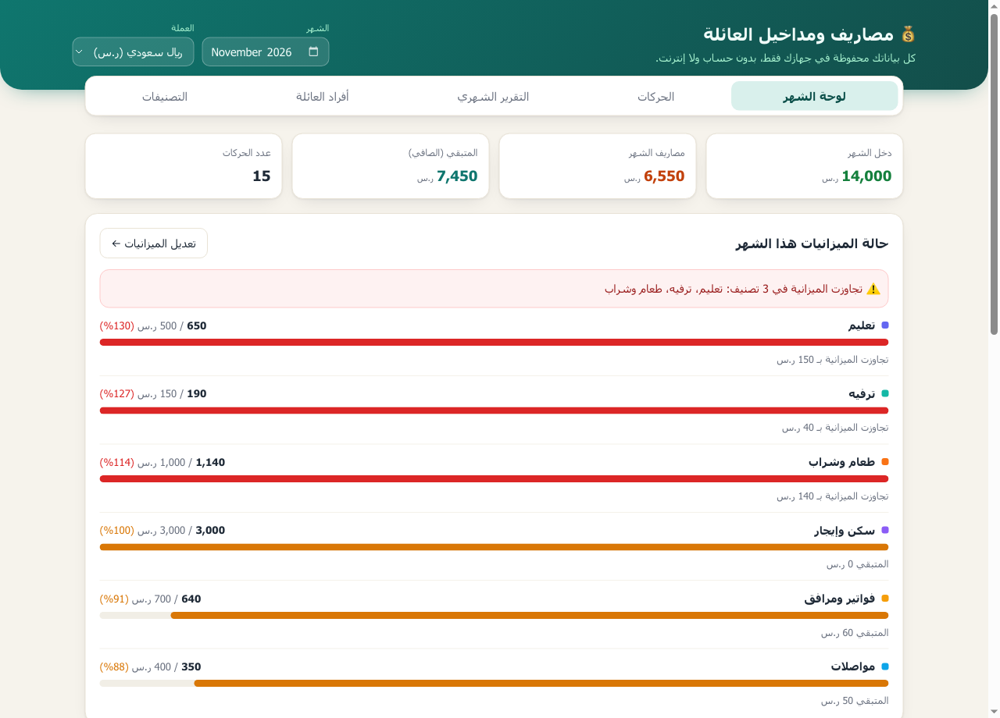
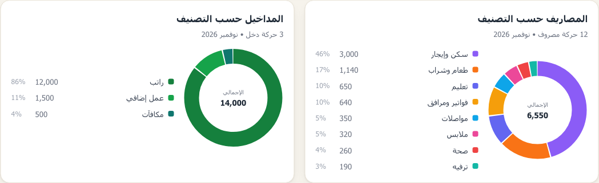
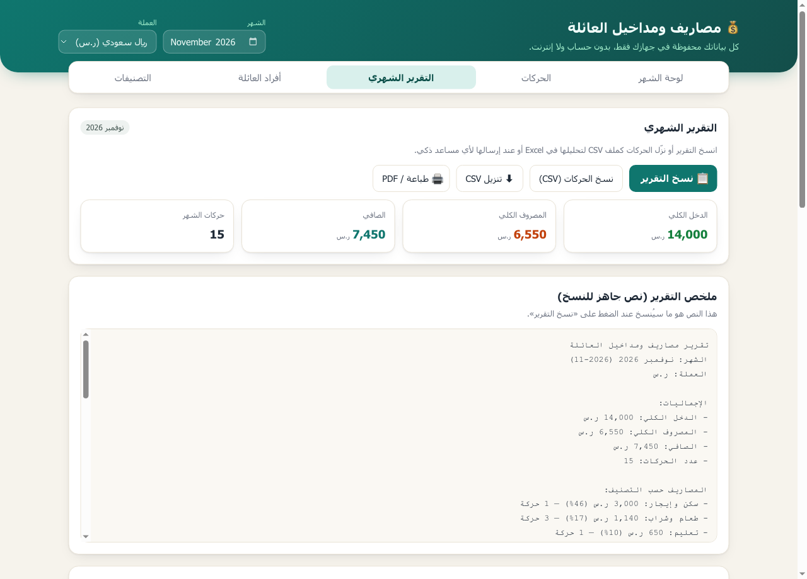
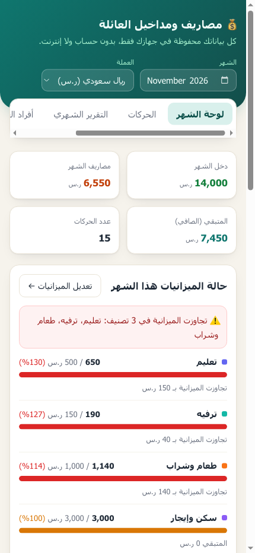
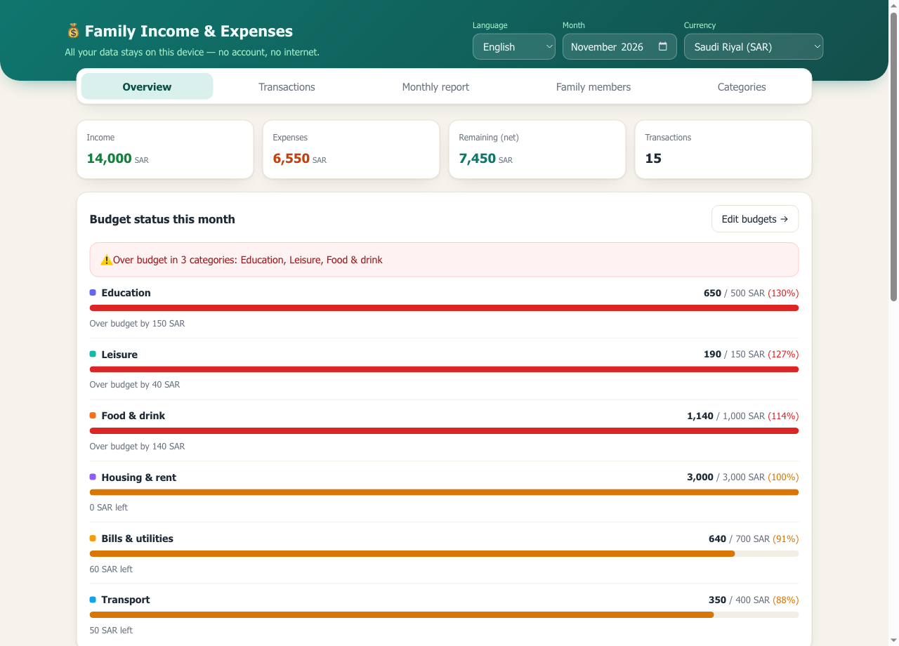
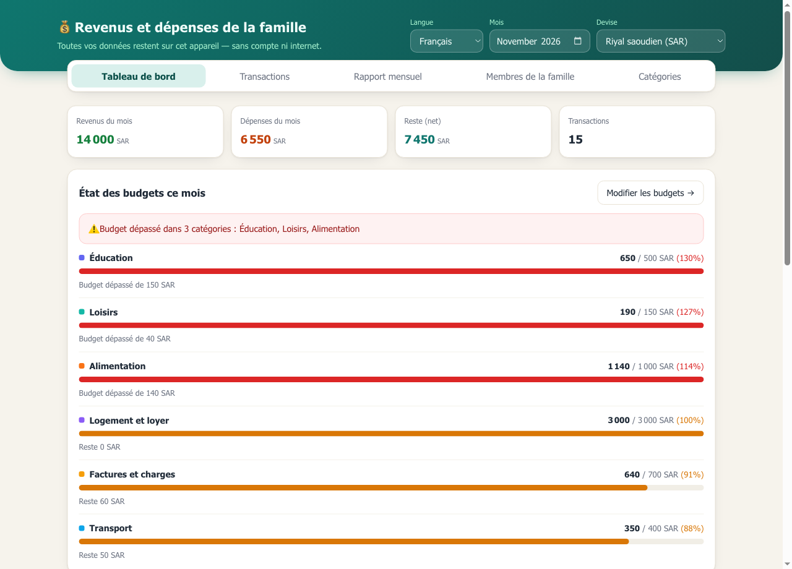
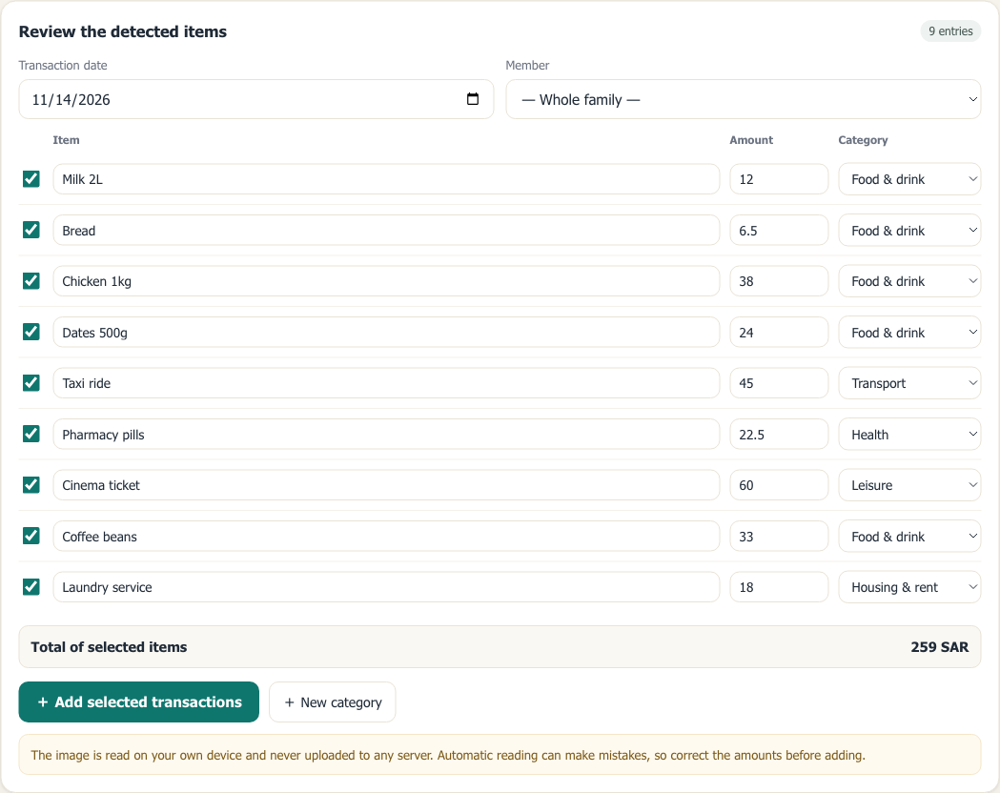

# مصاريف ومداخيل العائلة

تطبيق ويب بسيط لإدارة مصاريف ومداخيل العائلة، يعمل بالكامل داخل المتصفح دون خادم أو قاعدة بيانات، وواجهته عربية من اليمين إلى اليسار.

جرّب التطبيق مباشرة: **https://site-222ea84824f34fea97bb4ca0822cdba6.freebuff.page**

## صور من التطبيق







<p align="center">
  
</p>

### نفس التطبيق بالإنجليزية والفرنسية

<p align="center">
  
  
</p>

### مسح فاتورة بالكاميرا



الصورة تُقرأ داخل المتصفح ولا تُرفع إلى أي خادم: يُستخرج كل بند بمبلغه ويُصنَّف تلقائيًا، ثم تراجع البنود وتعدّلها قبل إضافتها حركات في الشهر.

## المزايا

- إدارة **أفراد العائلة** وربط كل حركة بصاحبها.
- **تصنيفات** جاهزة للمصاريف والمداخيل، مع إمكانية إضافة وحذف ما تريد.
- **رسم بياني دائري** للمصاريف وللمداخيل حسب التصنيف مع النسب المئوية.
- **تقرير شهري** كامل: الإجماليات، التوزيع حسب التصنيف، التوزيع حسب الأفراد، وتفصيل كل الحركات.
- **نسخ التقرير** كنص جاهز للتحليل، و**تصدير CSV** (بترميز UTF-8 يقرأ العربية في Excel) وزر طباعة / PDF.
- **ميزانية شهرية لكل تصنيف** مع شريط تقدم وتنبيه أصفر عند ٨٠٪ وأحمر عند التجاوز.
- **نسخة احتياطية JSON** للتنزيل والاستعادة.
- **مسح فاتورة بالكاميرا**: صوّر الإيصال أو حمّل صورته، فيقرأ التطبيق البنود والمبالغ داخل جهازك ويقترح تصنيفًا لكل بند، مع شاشة مراجعة تسمح بتصحيح المبلغ أو التصنيف وإضافة تصنيف جديد قبل الحفظ.
- يعمل **بدون إنترنت** بعد أول زيارة (Service Worker) وقابل للإضافة إلى الشاشة الرئيسية (PWA).
- **ثلاث لغات للواجهة**: العربية والإنجليزية والفرنسية، مع تبديل فوري، اتجاه تلقائي (RTL/LTR)، ترجمة التصنيفات الجاهزة وتقرير وCSV بلغة الواجهة.

## التشغيل

لا يحتاج أي بناء أو تثبيت. افتح `index.html` في المتصفح مباشرة، أو شغّل خادمًا بسيطًا:

```bash
python3 -m http.server 3000
```

ثم افتح <http://localhost:3000>.

## النشر

الملفات جاهزة للنشر على أي استضافة ثابتة (GitHub Pages، Cloudflare Pages، Netlify). لتفعيل GitHub Pages: Settings ← Pages ← Branch: `main` / root.

## البيانات والخصوصية

كل البيانات (الأفراد، التصنيفات، الحركات، الميزانيات، العملة) تُحفظ في `localStorage` داخل جهاز المستخدم فقط، ولا تُرسل إلى أي خادم. مسح بيانات المتصفح يمسح البيانات، لذا يُنصح بتنزيل نسخة احتياطية بشكل دوري.

## البنية

| الملف | الوظيفة |
| --- | --- |
| `index.html` | التطبيق كاملًا: الواجهة، التنسيقات، والمنطق |
| `manifest.webmanifest` | تعريف التطبيق (الاسم، الأيقونة، وضع standalone) |
| `sw.js` | عمل التطبيق بدون إنترنت |
| `icons/` | أيقونات التطبيق |
| `docs/screenshots/` | صور التطبيق المستخدمة في هذا الملف |
